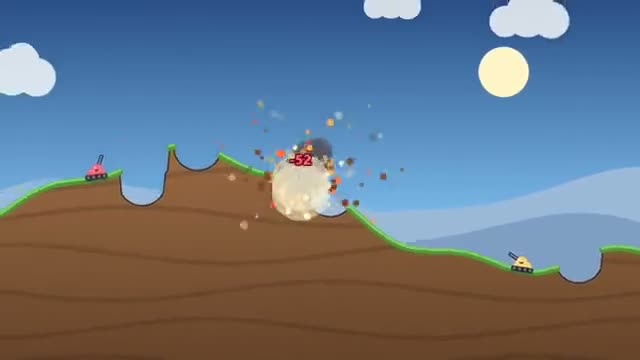

# Turn Artillery

Lob shells over the hills. Mind the wind. A multiplayer starter game from [Multiplayer Agent](https://multiplayeragent.com): 2D, turn-based, 2–4 players, with bots that take the empty tanks.

## How it plays

Take turns: drive a little, aim, pick your power and fire. The wind changes every turn and every shell digs a crater, so the hills change too. Last tank standing wins; after a while the water starts to rise.

**Controls:** Drag from your tank to aim and let go to fire, or arrow keys and hold Space.

## Make it yours in the Game Builder

Open the [Game Builder](https://multiplayeragent.com), choose **Start from a starter game** and pick Turn Artillery. It opens as version 1 in your studio, ready to play and publish. Then ask for changes, for example:

- Add a cluster shell that splits into three
- Let each player have a team of three tanks
- Make it on the moon with low gravity

## Run it yourself

1. Get a free publishable key (`pk_…`) at [multiplayeragent.com](https://multiplayeragent.com).
2. In `index.html`, put it in place of `pk_REPLACE_ME` in the `MP_CONNECT` block.
3. Open `index.html` in a browser. No build step and no server needed.

Without a key it still runs, offline against bots.

## How it is built

- One `index.html`. The comment at the top of the script maps the code and explains the multiplayer.
- **Leaderboard:** The players with the most match wins.
- **Host-run rules:** The host's browser checks each shot, works out where it lands and the damage, and runs the turns; if it leaves, the next player takes over.
- **Bots:** Bots take the empty tanks and aim with a little error, so you can play alone.
- **Live sync:** Everyone sees the same hills, the same shell and the same craters.
- `?attract` runs it offline with bots only. The preview video is recorded from it.

## License

MIT.
